<!-- profilescape:start -->

<picture>
  <source media="(prefers-color-scheme: dark)" srcset="https://raw.githubusercontent.com/chavez-113/chavez-113/profilescape-output/languages-dark.svg" />
  
</picture>

<!-- profilescape:end -->
